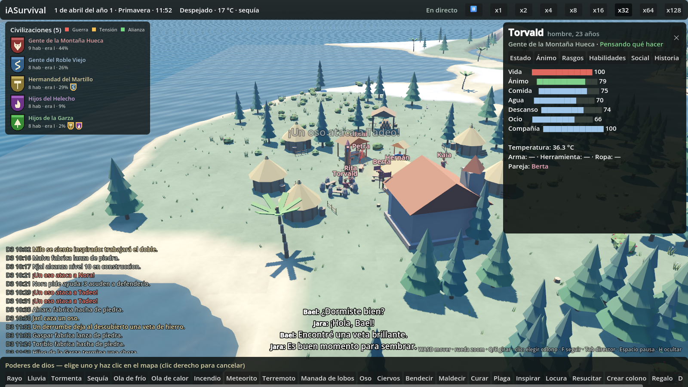
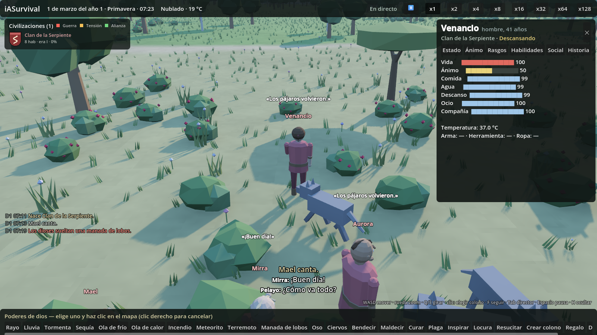
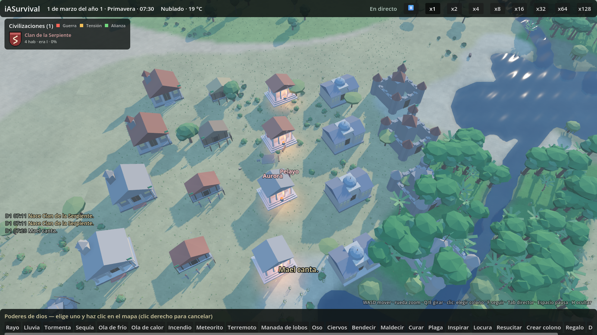

# iASurvival

**Civilizaciones de inteligencias que nacen en un solo pueblo y luego crecen, se dividen, guerrean y levantan imperios durante siglos. Tú observas… y a veces intervienes.**



iASurvival es un simulador de colonias con **comportamiento emergente**. Mezcla tres ideas:

- **colonias de supervivencia**: cada colono tiene necesidades, rasgos, ánimo, recuerdos y relaciones;
- **crecimiento de ciudades como en un RTS histórico**: centro urbano, casas, campamentos, edades y maravillas, pero las construye la IA, no tú;
- **un dios que observa**: no das órdenes. Miras como en un documental y usas 23 poderes para cambiar el rumbo de la historia.

Nadie escribe las historias: salen de cientos de pequeñas decisiones. Un pirómano que quema el granero en pleno invierno, un cisma que funda un pueblo rival al otro lado del río, un asedio que termina con la ciudad conquistada jurando lealtad al vencedor.

| | |
|---|---|
|  |  |

---

## Qué tiene

### Colonos con personalidad
- **100 rasgos** en 10 categorías: temperamento, social, trabajo, cuerpo, mente, moral, miedo, naturaleza, familia y rarezas. Cambian sus estadísticas, el gusto por cada trabajo, cómo les pega cada recuerdo y hasta conductas propias. El cleptómano roba, el glotón se atiborra, el sonámbulo pasea dormido y el cuentacuentos encanta junto al fuego.
- **5 ejes de personalidad**, **40 trasfondos**, **11 habilidades** con pasión y **241 nombres**.
- **Ánimo** hecho de recuerdos y pensamientos:
  - si baja mucho, llegan las **crisis**: furia, huida, atracón, robo, incendio o encierro;
  - si sube, llega la **inspiración**.
- **Vida social**: amistades, rivalidades, parejas, embarazos de 9 meses, gemelos y diálogos según el contexto.

### Tribus que piensan solas
- Un **consejo por tribu** decide qué hace falta y lo publica en un tablero: comida, madera, piedra, camas, obras, armas, abrigo, curas, vigilancia o apagar incendios.
- Cada colono elige su tarea con **IA por utilidad**, según su necesidad, su habilidad y sus rasgos.
- **Diplomacia**: paz, tensión, guerra y alianza. También caravanas, líderes, cismas y viajeros que fundan pueblos nuevos.
- **Imperios**: ejércitos que marchan en formación, asedios a murallas, **conquista** de ciudades y extinción.
- **Rango** de cada civilización: Clan → Aldea → Señorío → Reino → Imperio.

### Ciudades y edades
- Economía de RTS:
  - centro urbano;
  - casas que suben el tope de población;
  - campamentos junto a los recursos;
  - molino con granjas;
  - cuartel, galería, mercado, templo, universidad, castillo y maravilla.
- **4 edades** (Piedra → Cobre → Hierro → Pólvora), con requisitos y una **arquitectura que cambia** en cada una.
- **21 inventos** con inspiraciones caóticas: una tribu puede saltarse etapas. Además hay **24 mejoras** de edificio con efecto real.

### Un mundo vivo
- Mapa de **1536 m** con 12 biomas por latitud y humedad, cordilleras, mar, ríos con vados y minerales (carbón, cobre, hierro, oro y azufre).
- ~370 **yacimientos renovables** que descansan y vuelven a producir, y vetas nuevas con los años. Está pensado para partidas de siglos.
- **Calendario** de 12 meses y 4 estaciones. El clima trae lluvia, tormentas con rayos, nieve, niebla, sequías y olas de frío y de calor.
- Incendios que se propagan, fiebre contagiosa y fauna: conejos, ciervos, jabalíes, lobos en manada y osos.
- **Física y combate**:
  - colisiones reales: nadie cruza paredes ni agua;
  - bancos donde sentarse de verdad;
  - combos de espada, esquivas y bloqueos con escudo;
  - flechas y balas que vuelan;
  - árboles que caen.

### 23 poderes de dios

| Grupo | Poderes |
|---|---|
| Clima | rayo, lluvia, tormenta, sequía, ola de frío, ola de calor |
| Destrucción | incendio, meteorito, terremoto |
| Fauna | manada de lobos, oso, ciervos |
| Colonos | bendecir, maldecir, curar, plaga, inspirar, locura, resucitar, crear colono |
| Otros | regalo, discordia, paz |

---

## Cómo funciona

```
┌────────────────────────────┐   WebSocket   ┌──────────────────────────────┐
│ servidor/  (Node + TS)     │ ────────────▶ │ visor/  (Godot 4.7, 3D)      │
│ la simulación completa:    │   estado del  │ dibuja el mundo, la interfaz │
│ colonos, tribus, clima,    │   mundo       │ y la cámara de documental;   │
│ economía, guerra, guardado │ ◀──────────── │ envía poderes, velocidad y   │
│                            │   comandos    │ fichas de colonos            │
└────────────┬───────────────┘               └──────────────────────────────┘
             │
   servidor/nativo/  (Rust → WebAssembly): ruido del terreno y A* (8,5× más rápido)
```

- El **motor** (`servidor/src/dominio`) es TypeScript puro sobre **[TxNucleo](https://github.com/LATINALU/TxNucleo)**, una librería de mecánicas de juego del mismo autor. Usa sus módulos de supervivencia, IA por utilidad, navegación, narrativa, generación de mundo, persistencia y bucle de paso fijo.
- El **visor** es un proyecto de Godot 4.7. Todo el arte 3D es **propio y está generado por código**: low-poly con color por vértice, en `visor/scripts/modelos.gd` y `visor/shaders/`. No hay assets externos.
- El `.exe` final lleva su propio `node.exe` y el motor empaquetado con esbuild. El juego arranca el motor solo, sin instalar nada.

| Carpeta | Contenido |
|---|---|
| `servidor/src/dominio/` | colonos, ánimo, planificador, actividades, social, tribus, tecnología, fauna, clima, poderes, física, narrador |
| `servidor/src/dominio/datos/` | rasgos, trasfondos, nombres y diálogos |
| `servidor/nativo/` | núcleo en Rust compilado a `ias_nativo.wasm` (ya incluido) |
| `servidor/herramientas/` | simulación sin interfaz, medición de rendimiento, diagnóstico de muertes y empaquetado |
| `servidor/test/` | 21 pruebas: rasgos, colonias, colisiones, imperio e integración WebSocket |
| `visor/` | el juego en Godot: menú, mundo 3D, interfaz, cámara, emblemas y física visual |

---

## Compilar y jugar desde el código

Requisitos: **Node ≥ 23.6**, **Godot 4.7** y, de forma opcional, **Rust** si quieres recompilar el núcleo nativo.

iASurvival depende de TxNucleo como carpeta hermana:

```bash
git clone https://github.com/LATINALU/TxNucleo.git
git clone https://github.com/LATINALU/iASurvival.git
cd TxNucleo && npm install && cd ..
cd iASurvival/servidor && npm install
npm test        # 21 pruebas
```

**Jugar en el editor**: abre `visor/project.godot` con Godot 4.7 y pulsa F5. El visor lanza el motor con `node ../servidor/src/principal.ts`.

**Crear el `.exe`**:

```bash
cd servidor && node herramientas/empaquetar.ts        # motor → build/iASurvival/motor
godot --headless --path visor --export-release "Windows" ../build/iASurvival/iASurvival.exe
```

### Herramientas útiles

```bash
node herramientas/simular.ts --dias 6 --tribus 3 --colonos 5 --semilla 1   # simulación sin interfaz + informe
node herramientas/medir.ts --tam 1536                                      # ms por tick, nodos, tamaño del inicio
node herramientas/diag_muertes.ts --dias 24 --semilla 7 [--sed]            # qué hacía cada colono que murió
npm run tipos                                                              # comprobación de tipos
(cd nativo && cargo build --release --target wasm32-unknown-unknown && cp target/wasm32-unknown-unknown/release/ias_nativo.wasm .)
```

Para probar el visor de forma automática: `iASurvival.exe -- --auto=nuevo --semilla=3 --velocidad=4 --seguir=1 --captura=foto.png --tras=20`. También acepta `--poder=lobos`, `--retrato=3` y `--vitrina=centro,castillo,templo`.

---

## Controles

| Control | Acción |
|---|---|
| WASD / flechas, botón central arrastrando | mover la cámara |
| Rueda | acercar o alejar |
| Q / E (o Shift + clic derecho arrastrando) | girar |
| Clic sobre un colono | ficha: estado, ánimo, rasgos, habilidades, relaciones e historia |
| F | seguir al colono elegido |
| Tab | modo director: la cámara corta sola a lo interesante |
| Espacio · 1 … 8 | pausa · x1 … x128 (un año de juego dura ~4,5 min a x128) |
| Barra de poderes + clic en el mapa | usar un poder (Shift para repetir, clic derecho para cancelar) |
| H · F11 · Esc | ocultar la interfaz · pantalla completa · salir (guarda) |

El mundo se guarda solo cada minuto.

---

## Hoja de ruta

- **Salto de siglos**: avanzar décadas en segundos para ver partidas de 1000 años.
- **IAs externas**: una API HTTP para que modelos de lenguaje vivan dentro del mundo como colonos. El borrador está en [docs/API.md](docs/API.md).
- Globos de diálogo que no se solapen en multitudes.

## Licencia

Código, datos y arte de este repositorio: © 2026 LATINALU, bajo la licencia **LLVA 1.1** (ver [LICENSE](LICENSE)). Puedes usarlo, estudiarlo, modificarlo y publicar tus propias versiones, con atribución.

Construido sobre **[TxNucleo](https://github.com/LATINALU/TxNucleo)** de LATINALU.
